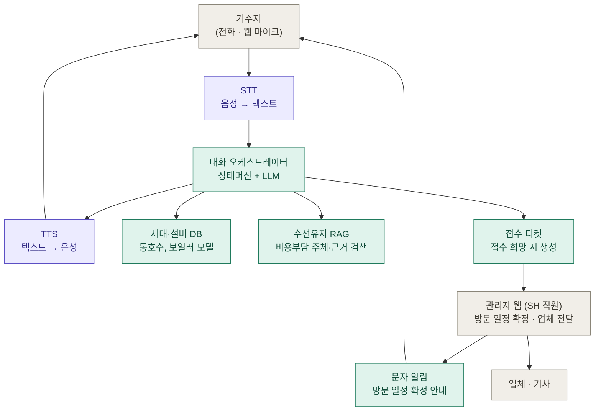

# HomeCareOn

**AI 음성 기반 주거시설 민원 접수 및 유지보수 연계 시스템**

한양대학교 기술혁신대학 정보공학전공

권승민, 김회규, 조준혁

---

## 무엇을 만드는가

SH공사 임대주택 거주자가 **전화 한 통으로** 시설물 고장을 접수하는 서비스입니다. AI가 대화로 고장 내용을 파악하고, 시설물 수선유지 기준에 따라 **비용을 누가 부담하는지, 거주자에게 비용이 발생할 수 있는지**를 먼저 안내합니다. 거주자가 접수를 원하면 정리된 내용이 SH 직원에게 전달되고, 직원은 **관리자 웹에서 방문 일정을 잡아 문자로 확정 안내**하고 업체에 전달합니다.

| 사용자 | 채널 | 하는 일 |
|---|---|---|
| 거주자 | 전화 (개발 중에는 웹 마이크로 대체) | 고장 내용을 말로 설명하고, 비용 부담 안내를 들은 뒤 접수 여부를 정한다. 방문 일정은 문자로 받는다 |
| SH 직원 | 관리자 웹 | 접수된 티켓을 확인하고, 방문 일정을 잡아 문자로 확정 안내하며, 업체·기사에 전달하고 처리 상태를 관리한다 |
| 업체·기사 | 직원에게 전달받은 내용 | 정리된 접수 내용을 보고 방문·수리한다 |

### 왜 필요한가

- 거주자는 업무 시간에만 전화가 되고, 수리비를 본인이 내야 하는지 모른 채 접수부터 해야 한다.
- 직원은 통화 내용을 직접 받아 적고, 동호수·설비 모델·비용 부담 기준을 따로 찾아본 뒤 업체에 다시 설명해야 한다.
- 업체는 "보일러가 안 돼요" 수준의 정보만 받고 출동하는 경우가 많다.

HomeCareOn은 접수 단계에서 **동호수, 설비 모델, 증상·에러코드, 비용 부담 주체와 근거**를 한 번에 정리해 이 반복 작업을 없앱니다. 방문 일정처럼 사람이 조율해야 하는 일은 AI가 정하지 않고 직원에게 남깁니다.

## 동작 흐름

**전화 접수 (AI)**

1. 거주자가 전화를 건다.
2. STT가 음성을 텍스트로 바꾸고, 대화 오케스트레이터가 상태머신에 따라 동호수와 증상을 차례로 묻는다.
3. 세대·설비 DB에서 동호수로 설치된 설비(예: 보일러 모델)를 조회한다.
4. 수선유지 RAG로 시설물 기준을 검색해 **비용 부담 주체(SH / 거주자)와 거주자 비용 발생 가능성**을 근거와 함께 안내한다.
5. 거주자에게 접수 여부를 묻는다. 접수를 원하면 티켓을 만들어 SH 직원에게 전달하고, 원하지 않으면 안내만 하고 통화를 마친다.

**접수 처리 (SH 직원, 관리자 웹)**

6. 직원이 티켓을 확인하고 방문 일정을 잡는다.
7. 웹에서 거주자에게 **문자 알림으로 방문 일정을 확정** 안내한다.
8. 업체·기사에 정리된 접수 내용을 전달하고, 처리 상태를 관리한다.

### 대화 예시

> **AI** 안녕하세요, SH 시설물 접수센터입니다. 동과 호수를 말씀해 주세요.
> **거주자** 백삼 동 천이백사 호요.
> **AI** 103동 1204호 맞으시죠? 어떤 문제가 있으신가요?
> **거주자** 보일러에 에러 공삼이 뜨고 온수가 안 나와요.
> **AI** 설치된 보일러 기준으로 에러 03은 점화 불량입니다. 수선유지 기준상 노후로 인한 고장은 SH가 부담합니다. 다만 점검 결과 사용 부주의로 확인되면 거주자 부담 비용이 발생할 수 있습니다. 접수해 드릴까요?
> **거주자** 네, 접수해 주세요.
> **AI** 접수되었습니다. 담당 직원이 확인한 뒤 방문 일정을 문자로 안내해 드리겠습니다.

## 시스템 구조



보라 = 음성 처리 · 청록 = 백엔드 서버 · 회색 = 사람

### 구성 요소

| 구성 요소 | 역할 |
|---|---|
| STT / TTS | 통화 음성과 텍스트 사이를 변환한다. 동호수·에러코드처럼 숫자로 읽히는 말("백삼 동", "에러 공삼")을 정규화하는 후처리를 포함한다. |
| 대화 오케스트레이터 | 상태머신이 대화 단계(세대 확인 → 증상 파악 → 비용 부담 안내 → 접수 의사 확인 → 마무리)를 통제하고, LLM이 각 단계에서 발화 이해·정보 추출·응답 생성을 맡는다. |
| 세대·설비 DB | 동호수별 세대 정보와 설치 설비(모델, 설치 연도)를 보관한다. |
| 수선유지 RAG | 수선유지 기준 문서와 에러코드 매뉴얼을 검색해 근거를 찾고(`search_policy()`), 규칙 표로 비용 부담 주체와 거주자 비용 발생 가능성을 판정한다(`decide_liability()`). |
| 접수 티켓 | 거주자가 접수를 원할 때 대화 내용을 정리해 생성하고 SH 직원에게 전달한다. |
| 관리자 웹 | SH 직원이 티켓을 확인하고, 방문 일정을 잡아 문자로 확정 안내하며, 업체·기사에 전달하고 상태를 관리한다. |
| 문자 알림 | 직원이 확정한 방문 일정을 거주자에게 보낸다. (초기에는 목업) |

### 설계 원칙

- **비용 부담 판정은 LLM이 지어내지 않는다.** 규칙 표와 검색된 근거 조항으로 결정하고, 근거를 티켓에 함께 남긴다.
- **AI의 비용 안내는 기준에 따른 사전 안내다.** 최종 부담 주체는 현장 점검 후 달라질 수 있음을 거주자에게 함께 알린다.
- **방문 일정은 AI가 잡지 않는다.** 접수까지만 AI가 하고, 일정 확정과 업체 전달은 SH 직원이 한다.
- **대화 흐름은 상태머신이 쥔다.** LLM은 단계 안에서의 이해와 표현만 담당하므로, 필수 정보 누락 없이 접수가 끝난다.
- **판단이 어려우면 사람에게 넘긴다.** 규칙에 없는 경우나 인식이 반복 실패하는 경우 "직원 확인 필요" 티켓으로 올린다.

## 관리자 웹

직원이 업체에 다시 설명할 필요가 없도록, 티켓 한 장에 전달에 필요한 내용을 모두 담습니다.

- **티켓 목록** — 신규 접수, 상태별 필터
- **티켓 상세** — 동호수, 설비 모델, 증상·에러코드, 비용 부담 주체와 근거, 통화 요약
- **방문 일정 확정** — 일정을 입력하면 거주자에게 문자 알림 발송
- **업체·기사 전달** — 담당 지정 후 정리된 접수 내용을 그대로 전달
- **상태 관리** — 접수 → 일정 확정 → 처리 중 → 완료

## 역할 분담

| | 담당 영역 | 주요 작업 | 결과물 |
|---|---|---|---|
| **A. 대화·음성** | 대화 엔진 + 음성 + 거주자 화면 | 상태머신, LLM 프롬프트, 정보 추출 형식, 동호수·에러코드 숫자 변환, STT/TTS 연동, 마이크 버튼 웹 | 말하면 대답하는 접수 화면 |
| **B. 지식·데이터** | RAG + 규칙 표 + 데이터 + 평가 | 수선유지 기준 문서와 에러코드 매뉴얼 수집, 문서 분할과 임베딩, 비용 부담 규칙 표, 목업 세대·설비 데이터, 테스트 시나리오 | `search_policy()`, `decide_liability()` 함수, 테스트 결과표 |
| **C. 백엔드·운영** | 서버 + DB + 관리자 화면 | FastAPI, DB 스키마, 세대 조회·티켓 API, 방문 일정 확정과 문자 알림(목업), 업체 전달, 관리자 웹 | 도구 API 전체, 티켓 관리 화면 |

세 파트는 **도구 API**(세대 조회, 정책 검색·판정, 티켓 생성)를 경계로 나뉩니다. API 형식을 먼저 합의하면 A는 목업 응답으로, B·C는 각자 구현으로 병렬 개발할 수 있습니다.

## 디렉토리 구조

```
homecaron/
├── backend/     # FastAPI 서버, 대화 오케스트레이터, 도구 API, DB
├── frontend/    # 관리자 웹, 웹 마이크 접수 화면
├── knowledge/   # 수선유지 기준 문서, 에러코드 매뉴얼, 비용 부담 규칙 표, 목업 데이터
│   ├── sources/        # 원본 문서 (SH 비용부담 기준 HWP·PDF)
│   ├── cost_standard/  # 비용부담 기준을 구조화한 RAG 데이터 (항목 457개, 조항·용어 40개)
│   └── tools/          # 원본 → 구조화 데이터 변환 스크립트
├── tests/       # 테스트 시나리오와 결과표
└── docs/        # 설계 문서, API 명세, 회의록
```

## 기술 스택

| 영역 | 선택 |
|---|---|
| 백엔드 | Python, FastAPI |
| DB | 미정 |
| LLM | 미정 |
| STT / TTS | 미정 |
| 임베딩·벡터 검색 | 미정 |
| 프런트엔드 | 미정 |
| 전화 연동 | 미정 (초기에는 웹 마이크로 대체) |
| 문자 알림 | 목업 → 실제 발송은 추후 결정 |

## 개발 단계

1. **도구 API 형식 합의** — 세대 조회, 정책 검색·판정, 티켓 생성의 입출력 정의
2. **텍스트 대화 완성** — 음성 없이 텍스트로 증상 파악부터 비용 안내, 티켓 생성까지 한 흐름 연결
3. **음성 연결** — 웹 마이크 + STT/TTS로 말하면 대답하는 접수 화면
4. **관리자 웹** — 티켓 목록·상세, 방문 일정 확정과 문자 알림, 업체 전달, 상태 관리
5. **시나리오 평가** — 테스트 시나리오로 정보 추출 정확도와 비용 부담 판정 정확도 측정
6. **전화 연동** — 실제 전화 회선 연결

## 실행 방법

아직 코드가 없습니다. 백엔드·프런트엔드 골격이 잡히면 이 절에 설치와 실행 방법을 적습니다.
